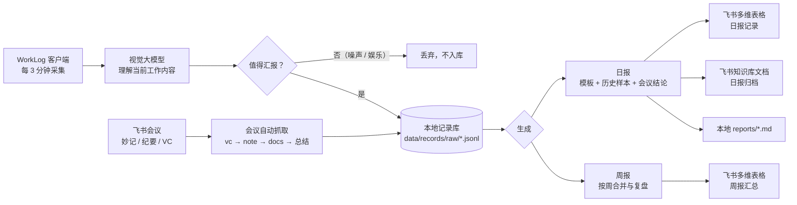

<div align="center">

# WorkLog · 工作汇报采集器

**本地采集 → AI 清洗 → 日报 / 周报 → 飞书多维表格与知识库，一条链路跑完。**

一个跑在自己电脑上的轻量桌面程序（Rust + Tauri，安装包 3 MB 级、常驻内存 30 MB 级），
把「今天到底干了什么」这件事自动化，并把结果直接写进飞书。

[](https://www.rust-lang.org/)
[](https://tauri.app/)
[]()
[](LICENSE)

</div>

---

## 目录

- [为什么做这个](#为什么做这个)
- [功能特性](#功能特性)
- [工作原理](#工作原理)
- [快速开始](#快速开始)
- [首次配置](#首次配置)
- [飞书侧准备](#飞书侧准备)
- [命令行用法](#命令行用法)
- [项目结构](#项目结构)
- [数据与隐私](#数据与隐私)
- [应用案例](#应用案例)
- [Roadmap](#roadmap)
- [License](#license)

---

## 为什么做这个

写日报最消耗时间的从来不是「写」，而是三件事：

1. **想不起来**：一天开了 4 个会、改了 3 个方案，到晚上 18 点全糊成一团；
2. **写不准**：凭记忆写出来的日报，往往只有动作没有结果，量化数据尤其缺失；
3. **写不完**：日报、周报、月报、复盘各写一遍，同一件事反复描述。

WorkLog 的思路是把这件事拆成 **采集 → 清洗 → 生成 → 归档** 四段，每段都交给最合适的执行者：

| 环节 | 由谁做 | 说明 |
| --- | --- | --- |
| 采集 | 本机定时截图 + 视觉大模型 | 每 3 分钟一次，理解你此刻在做什么，而不是记录键盘、不做行为监控 |
| 清洗 | 大模型分类 + 关键词黑名单 | 只留下「值得汇报」的工作，刷视频、看购物车、游戏直接丢弃 |
| 生成 | 模板 + 历史样本 + 会议结论 | 按你过去的日报风格和颗粒度写，避免 AI 味和空指标 |
| 归档 | 飞书多维表格 + 飞书知识库文档 | 结构化入库，同时沉淀成可检索的知识库 |

> 全流程数据留在本机，只有「工作摘要文本」会发给大模型，截图用完即弃、不落盘。

---

## 功能特性

### 📸 记录：不需要你动手

- **定时自动采集**：默认每 3 分钟截一次屏，交给视觉模型判断当前在做什么，输出一条结构化工作记录（事项 / 项目归属 / 是否值得汇报）
- **跨天不丢事**：日报统计窗口是「昨天推送时刻 → 今天推送时刻」，晚上加班的内容会进第二天的日报，不会漏也不会重复
- **噪音过滤**：模型侧 `reportable` 标记 + 自定义关键词黑名单（默认已含影视、游戏、购物、短视频等）双保险
- **历史导入**：一条命令把旧的 dailylog 采集记录和历史日报导进来，冷启动不用从零开始

### 🎙 会议：自动抓当天纪要

- 对接飞书视频会议，自动完成 `会议搜索 → 会议详情 → 纪要 note → 文档正文 → 提取「总结」` 整条链路
- 生成日报时自动把当天的会议结论融进去，**每个会议都是一个独立主题**，而不是复述聊天记录
- 也支持手动粘贴妙记 / 纪要链接作为兜底

### 📝 日报 / 周报：写成业务语言

- 日报按「今日核心成果 / 推进中事项 / 明日计划 / 需要协调」组织，要求写结果、结论、真实产出，不写应用时长和虚指标
- **知识沉淀**：把你过去写得好的日报、复盘样本作为 few-shot 参考，模型学的是**你的**写法
- 周报按「已推动能力 / 本周验证 / 遗留问题 / 下周计划 / 需要协调」五段式汇总，直接可交给上级
- 生成后本地缓存，历史随时回看，支持回填反馈继续优化

### 📊 飞书闭环

- 日报一键写入飞书多维表格（日期 / 部门 / 姓名 / 数据来源 / 内容），字段可配置
- 自动归档追加到指定飞书知识库文档，形成按日期索引的日报库
- 支持定时自动推送（默认 18:10），到点自己发，不用设闹钟
- 托盘常驻，关窗不收工，配合飞书多维表格工作流可继续触发周报、催办、复盘

### ⚙️ 工程实现

- **Rust + Tauri 2**：单文件 exe，启动即用，无需装 Python / Node / 浏览器内核（仅依赖系统自带 WebView2）
- **本地优先**：所有数据是磁盘上的 JSONL + Markdown，随时可以 grep、可以备份、可以迁移
- 界面自带概览看板、今日记录时间轴、日报列表、数据分析（趋势 / 分布 / 方向进度）与设置页

---

## 工作原理



### 跨日窗口设计

日报写的不是「自然日 0 点到 24 点」，而是 **上一次推送时刻 → 本次推送时刻**：

```
10-17 18:10 推送 ──────────────► 10-18 18:10 推送
              └── 这段时间的记录，就是 10-18 的日报 ──┘
```

好处是：晚上 21 点做的事不会被切到「昨天」，白天忘了推送也不会重复统计。程序用 `data/last_push.json` 记住上次推送时刻，历史任意一天也能用同样规则回溯重算。

---

## 快速开始

### 方式一：直接用（推荐给使用者）

1. 从 [Releases](../../releases) 下载 `WorkLog-vX.Y.Z-便携版.zip`，解压到任意目录（例如 `D:\WorkLog`）
2. 双击 `worklog.exe` 启动
3. 打开「设置」页，填模型 API Key、飞书多维表格 token、你的 open_id 等信息
4. 保持程序在托盘运行，之后每天 18:10 会自动把日报写进飞书

**运行要求**：Windows 10 / 11 + 系统自带 WebView2 运行时（Win11 及近期 Win10 已内置；若提示缺失，装一次 [WebView2 Runtime](https://developer.microsoft.com/microsoft-edge/webview2/)）。
便携版无需安装、无需管理员权限，删除目录即卸载。

### 方式二：从源码构建（推荐给开发者）

```powershell
# 1. 准备 Rust（Windows GNU 工具链）
#    rustup default stable-x86_64-pc-windows-gnu
#    并把 mingw64\bin 放进 PATH
$env:PATH = "D:\mingw64\mingw64\bin;" + $env:PATH

# 2. 构建
cd src-tauri
cargo build --release

# 3. 产物
#    src-tauri\target\release\worklog.exe
#    src-tauri\target\release\WebView2Loader.dll   ← 必须与 exe 放在同一目录
```

> GNU 工具链的 Tauri 构建不会静态链接 `WebView2Loader.dll`，打包分发时请把它一起放进去。
> 前端资源（`ui/`）在编译期嵌入 exe，改完界面需要重新 `cargo build`。

---

## 首次配置

配置文件在 **exe 同目录** 的 `data/settings.json`，也可以直接在程序「设置」页里改（推荐）。

| 字段 | 默认值 | 说明 |
| --- | --- | --- |
| `interval_minutes` | `3` | 采集间隔（分钟） |
| `recording_enabled` | `true` | 是否开启自动采集 |
| `model_base_url` | `https://api.deepseek.com` | 模型服务地址（OpenAI 兼容） |
| `model_name` | `deepseek-v4-flash-vision-exp` | 需要**支持图片输入**的模型 |
| `model_api_key` | 空 | 你的 API Key（只存本地） |
| `work_directions` | 见默认值 | 工作方向清单，模型按它给记录归类并统计进度 |
| `report_template` | 见默认值 | 日报提示词模板，可完全自定义成公司格式 |
| `weekly_template` | 见默认值 | 周报提示词模板 |
| `reference_samples` | 空 | 历史日报 / 复盘样本，用于模仿你的写作风格 |
| `exclude_keywords` | 空 | 不需要汇报的关键词，每行一个 |
| `feishu_enabled` | `true` | 是否启用飞书写入 |
| `feishu_base_token` | 示例值 | 多维表格 app token（`/base/` 后面那段） |
| `feishu_table_id` | 示例值 | 日报记录表 table id（`?table=` 后面那段） |
| `feishu_dept` | `教学运营` | 写入「部门」字段 |
| `feishu_user_name` / `feishu_user_open_id` | 空 | 你自己的姓名与 open_id（由「通讯录」接口解析） |
| `feishu_auto_push_enabled` | `true` | 是否定时自动推送 |
| `feishu_push_hour` / `feishu_push_minute` | `18` / `10` | 推送时刻，也是跨日窗口的分界点 |
| `knowledge_doc_token` | 空 | 日报归档的目标飞书文档 token，留空则不归档 |
| `knowledge_archive_enabled` | `true` | 是否自动归档 |
| `meeting_auto_fetch` | `true` | 生成日报时是否合并会议内容 |
| `meeting_auto_vc` | `true` | 是否自动从 VC 会议抓取当天纪要 |
| `meeting_links` / `meeting_notes` | 空 | 手动补充的妙记链接 / 纪要文本（兜底） |

> 仓库里的默认 token 是作者自己的示例空间地址，请替换成你自己的。

---

## 飞书侧准备

WorkLog 通过 [`lark-cli`](https://www.npmjs.com/package/@larksuiteoapi/lark-cli)（用户身份）访问飞书，因此需要先登录一次：

```powershell
lark-cli auth login                 # 扫码登录，token 会自动续期
lark-cli auth status                # 确认状态为 valid
```

需要用到的能力（业务域）大致是：

| 域 | 用途 |
| --- | --- |
| `base` | 读写多维表格：日报记录、周报汇总 |
| `docx` / `docs` | 拉取会议纪要正文、追加归档日报 |
| `drive` | 文档元信息、知识库归档 |
| `vc` | 搜索当天的视频会议 |
| `note` | 取会议纪要（note）与对应文档 token |
| `minutes` | 妙记链接解析 |

### 多维表格需要这样建

**日报记录表**（写入目标），至少包含：

| 字段名 | 类型 | 说明 |
| --- | --- | --- |
| 日期 | 日期 | 日报所属日期 |
| 部门 | 多选 / 文本 | 写入 `feishu_dept` |
| 姓名 | 人员 | 写入你的 open_id |
| 数据来源 | 多选 | 需要有一个 `worklog` 选项，用于区分手工填报与自动生成 |
| 内容 | 多行文本 | 日报正文 |

**周报汇总表**：日期区间、周次、内容等字段同理。

配上多维表格的自动化（定时 / 记录新增 / 按钮触发），就能继续往后接周报汇总、催办提醒、复盘动作项闭环等流程——WorkLog 只负责把「每天最脏的那段原始素材」变成结构化的干净数据。

---

## 命令行用法

除了界面操作，也可以挂到计划任务里跑：

```powershell
worklog.exe --push                      # 生成并推送今天的日报
worklog.exe --push --force              # 强制重推（忽略上次推送时刻）
worklog.exe --push --date 2026-10-15    # 补推指定日期（按历史窗口重算）
worklog.exe --weekly-report             # 生成并推送本周周报
worklog.exe --weekly-report --week 42   # 指定 ISO 周
worklog.exe --import-dailylog --days 30 # 导入旧 dailylog 采集记录
```

---

## 项目结构

```
worklog-rs/
├── ui/                        # 前端（编译期嵌入 exe，无构建步骤）
│   ├── index.html             # 五个页面：概览 / 今日记录 / 日报 / 数据分析 / 设置
│   ├── style.css
│   └── app.js                 # 通过 window.__TAURI__.core.invoke 调后端
└── src-tauri/
    ├── Cargo.toml
    ├── tauri.conf.json
    ├── capabilities/default.json
    ├── icons/
    └── src/
        ├── main.rs            # 应用入口、托盘、命令注册、CLI 模式
        ├── config.rs          # 配置读写、跨日窗口、本地缓存与日志
        ├── capture.rs         # 定时截图 + 视觉模型理解 → 结构化记录
        ├── records.rs         # 记录存储（JSONL）、清洗、按窗口查询
        ├── analyze.rs         # 日报 / 周报生成（模板 + 知识沉淀 + 会议融合）
        ├── meetings.rs        # 飞书会议自动抓取（vc → note → docs → 总结）
        ├── knowledge.rs       # 参考样本导入与知识沉淀
        ├── feishu.rs          # 多维表格写入、日报归档、推送
        └── stats.rs           # 数据分析聚合（趋势、分布、方向进度）
```

---

## 数据与隐私

- **截图不落盘**：采集时截图只在内存中编码后发送给模型，用完即弃
- **只有摘要上云**：发给大模型的是「当前窗口标题 + 屏幕内容理解结果」这类工作摘要文本
- **本地存储**：`data/records/raw/*.jsonl`（原始记录）、`data/reports/*.md`（日报）、`data/worklog.log`（运行日志）
- **密钥本地**：API Key 存在 `data/settings.json`，只在调用模型时使用；`.gitignore` 已把 `data/` 排除
- **不做行为监控**：没有键盘记录、没有进程审计、没有上传给任何管理后台——这是给自己用的工具，数据归属你自己

---

## 应用案例

本工具源于一个真实的运营 / 产研协作场景：一个人同时推进 10+ 条工作方向（AI 工作汇报闭环、线索转化、私域激活、话术库平台、智能问答、决策智能体等），
每天的原始素材散落在会议、文档、聊天和代码里。

接入之后的效果：

- 日报从「晚上挤 30 分钟回忆」变成「18:10 自动生成、2 分钟校对」，**日均节省约 25 分钟**
- 日报量化数据覆盖率明显提升：因为会议纪要和数据结论是被自动抓取进上下文的，不再依赖记忆
- 周报不再是「把五份日报粘一起」，而是按项目合并、按验证结论重写
- 同一套结构化数据继续供飞书多维表格的自动化流程使用（晨报、复盘、催办、动作项），形成「采集 → 汇报 → 复盘 → 行动」的闭环

> 如果你也在用 WorkLog，欢迎在 [Discussions](../../discussions) 里留下你的用法和效果，我会汇总进案例。

---

## Roadmap

- [ ] 支持 macOS / Linux 构建
- [ ] 采集端支持多屏与隐私窗口白名单（自动跳过网银、密码管理器等）
- [ ] 日报支持「一句话补充」再生成，不必重跑全流程
- [ ] 会议纪要支持自动提炼「决议 / 待办 / 负责人」并写入飞书任务
- [ ] 内置统计仪表盘导出 PNG / 写入飞书文档

---

## License

[MIT](LICENSE) © JAM-IU
